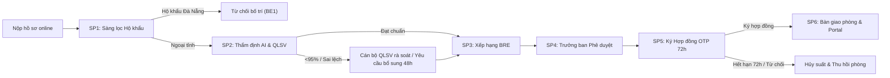

# 📋 TÀI LIỆU QUY TRÌNH CHUẨN DỰ ÁN HỌC PHẦN MIS3047 - KTX DUE
> **Dự án:** Hệ thống Quản lý Tuyển sinh & Bố trí Nội trú Ký túc xá Đại học Kinh tế – Đại học Đà Nẵng (DUE)  
> **Mô hình kiến trúc quy trình:** To-Be Collaboration Process Model (BPMN 2.0 - Nhóm 4)  
> **Mục đích:** Khóa cứng toàn bộ luồng nghiệp vụ, thẩm quyền và quy tắc kỹ thuật để đội ngũ phát triển tuân thủ tuyệt đối, không đi lệch hướng.

---

## 🏛️ 1. CƠ CẤU CHỦ THỂ & PHÂN QUYỀN (POOLS & LANES)

Mô hình gồm 2 Bể chứa (Pools) và 3 Làn phân quyền (Lanes) thuộc Ban Quản lý KTX:

```
┌────────────────────────────────────────────────────────────────────────────────────────┐
│ POOL 1: BAN QUẢN LÝ KTX (NHÀ TRƯỜNG) - TO-BE                                            │
├────────────────────────────────────────────────────────────────────────────────────────┤
│ 👤 LANE 1: TRƯỞNG BAN QUẢN LÝ KTX (Thẩm quyền pháp lý cao nhất)                        │
│    - SP4: Chốt & Phê duyệt danh sách chính thức (Quyết định B2 - 1-Click Dashboard)    │
│    - Chỉnh sửa / Yêu cầu điều chỉnh danh sách trước khi ban hành                      │
├────────────────────────────────────────────────────────────────────────────────────────┤
│ 👤 LANE 2: BỘ PHẬN HÀNH CHÍNH (Tiếp nhận & Sàng lọc ban đầu)                           │
│    - A1: Tiếp nhận hồ sơ đăng ký online từ cổng sinh viên                              │
│    - SP1: Sàng lọc hộ khẩu Đà Nẵng (Gateway XOR A4 - Err_HoKhau)                       │
│    - R1: Cập nhật hồ sơ từ chối bố trí KTX & gửi email thông báo từ chối (ETC)         │
├────────────────────────────────────────────────────────────────────────────────────────┤
│ 👤 LANE 3: BỘ PHẬN QUẢN LÝ SINH VIÊN (QLSV) (Chuyên môn & Vận hành)                     │
│    - SP2: Thẩm định minh chứng AI Vision & Rà soát thủ công / Xử lý bổ sung 48h        │
│    - SP3: Vận hành Business Rules Engine (BRE) xếp hạng ưu tiên thời gian thực        │
│    - SP5: Đối soát, phát hành email kèm Hợp đồng điện tử 72h & Xử lý xác thực OTP     │
│    - SP6: Đón tiếp check-in, bàn giao chìa khóa & Ghi nhận số phòng lên Portal KTX     │
└────────────────────────────────────────────────────────────────────────────────────────┘

┌────────────────────────────────────────────────────────────────────────────────────────┐
│ POOL 2: TÂN SINH VIÊN (Người dùng bên ngoài)                                           │
│    - Nộp hồ sơ đăng ký trực tuyến kèm ảnh chụp CCCD & Minh chứng ưu tiên               │
│    - Bổ sung minh chứng hợp lệ trong vòng 48 giờ (nếu bị yêu cầu)                      │
│    - Theo dõi thứ hạng real-time trên Bảng xếp hạng                                    │
│    - Nhận quyết định trúng tuyển, ký hợp đồng điện tử qua OTP trong 72 giờ              │
│    - Check-in nhận phòng và chìa khóa thực tế tại Ký túc xá                            │
└────────────────────────────────────────────────────────────────────────────────────────┘
```

---

## 🔄 2. CHI TIẾT 6 PHÂN HỆ QUY TRÌNH (SUB-PROCESSES SP1 ➔ SP6)



---

### 🔹 BƯỚC 1 (SP1): TIẾP NHẬN & SÀNG LỌC HỒ SƠ
* **Thực hiện:** Bộ phận Hành chính (`Lane_HC`).
* **Nhiệm vụ:**
  - Nhận hồ sơ đăng ký từ Tân sinh viên qua Portal trực tuyến (`Msg_DK`).
  - Ghi nhận hồ sơ vào `DataStore_HS` (CSDL hồ sơ đăng ký).
* **Cổng điều kiện (Gateway A4 - Hộ khẩu Đà Nẵng):**
  - **CÓ (Hộ khẩu TP. Đà Nẵng):** Vi phạm quy chế nhà trường (Cổng XOR 1 / Sự kiện lỗi `BE1 - Err_HoKhau`). Cập nhật trạng thái `TU_CHOI_BO_TRI`, gửi Email từ chối qua sự kiện `ETC (Msg_TuChoi)`. Kết thúc tiến trình.
  - **KHÔNG (Hộ khẩu ngoại tỉnh):** Hồ sơ hợp lệ ban đầu, chuyển tiếp sang Phân hệ 2 (`SP2`).

---

### 🔹 BƯỚC 2 (SP2): THẨM ĐỊNH MINH CHỨNG & XỬ LÝ BỔ SUNG
* **Thực hiện:** AI Vision Engine kết hợp Bộ phận QLSV (`Lane_QLSV`).
* **Hoạt động AI (Task A6):** Quét nhận diện ảnh CCCD và Giấy tờ ưu tiên.
* **Ngưỡng phân nhánh (Gateway A7 - Độ tin cậy 95%):**
  - **Độ tin cậy ≥ 0.95 (≥ 95%):** AI tự động phê duyệt thông qua (`is_valid_document = true`, `decision = THAM_DINH_DAT`). Đi thẳng sang Bước 3 (Xếp hạng).
  - **Độ tin cậy < 0.95 (< 95%) hoặc Lỗi API (`Err_AI`):** Bắt buộc giữ hồ sơ trong hàng đợi để Cán bộ QLSV rà soát thủ công (`Task A9 / MAN`). **Tuyệt đối không tự động bỏ qua hay xóa rỗng hàng đợi.**
* **Thẩm định thủ công của Cán bộ QLSV (Gateway GK):**
  - **ĐẠT:** Cán bộ bấm "Duyệt Đạt", trạng thái cập nhật `THAM_DINH_DAT`. Lưu cứng CSDL, chuyển tiếp sang Bước 3.
  - **KHÔNG ĐẠT:** Cán bộ gửi Email yêu cầu bổ sung minh chứng (`Msg_YCBS - TR`), mở đồng hồ đếm ngược 48 giờ (`Event Gateway EB1`).
    - *Nhánh 1 (`CO`):* Sinh viên tải lại minh chứng hợp lệ trong 48h ➔ AI Vision quét lại.
    - *Nhánh 2 (`TO`):* Quá hạn 48h không nộp bổ sung ➔ Task `R2`: Cập nhật trạng thái `KHONG_DUOC_XET`, gửi Email thông báo loại hồ sơ qua sự kiện `EO (Msg_KhongXet)`.

---

### 🔹 BƯỚC 3 (SP3): XẾP HẠNG ƯU TIÊN THỜI GIAN THỰC (BRE)
* **Thực hiện:** Bộ phận QLSV (`Lane_QLSV`) qua Business Rules Engine (`Task BRE`).
* **Bảng điểm ưu tiên (Bắt buộc tuân thủ 100%):**
  - **Con Liệt sĩ, Thương binh nặng:** `+40 điểm`
  - **Hộ nghèo, hộ cận nghèo chuẩn quốc gia:** `+35 điểm`
  - **Khu vực vùng sâu, vùng xa, hải đảo (> 100km):** `+30 điểm`
  - ⚠️ **KHÔNG THUỘC DIỆN ƯU TIÊN (`KHONG`):** BẮT BUỘC `0 ĐIỂM`. **Tuyệt đối cấm cộng điểm (+35) cho diện này.**
* **Thời điểm tính điểm:** Chỉ các hồ sơ đã có trạng thái `THAM_DINH_DAT` mới được cộng điểm ưu tiên.
* **Chốt đợt tuyển:** Sự kiện Timer `TA` ("Hết hạn đăng ký online Đợt 1") đóng sổ tiếp nhận để chuyển sang phê duyệt.

---

### 🔹 BƯỚC 4 (SP4): CHỐT & PHÊ DUYỆT DANH SÁCH CHÍNH THỨC
* **Thực hiện:** Duy nhất TRƯỞNG BAN QUẢN LÝ KTX (`Lane_TB`).
* **Nhiệm vụ:**
  - `Task CHOT`: Rà soát ràng buộc chỉ tiêu (Top 120 chỗ đợt 1), chống trùng lặp, điều kiện giới tính.
  - `Task B2`: Trưởng Ban phê duyệt chính thức bằng chữ ký điện tử / 1-Click trên Dashboard.
* **Cổng phê duyệt (Gateway B3):**
  - **THÔNG QUA (Có hiệu lực pháp lý):** Ban hành Quyết định phê duyệt. Chuyển quyền phát hành sang QLSV.
  - **KHÔNG THÔNG QUA:** Trưởng ban yêu cầu chỉnh sửa (`Task CS`), chuyển về QLSV điều chỉnh trước khi ký lại.

---

### 🔹 BƯỚC 5 (SP5): PHÁT HÀNH THÔNG BÁO & KÝ HỢP ĐỒNG ĐIỆN TỬ (OTP 72H)
* **Thực hiện:** Bộ phận QLSV (`Lane_QLSV`).
* **Nhiệm vụ:**
  - `Task LK`: Khóa danh sách, đối soát số lượng thí sinh trước phát hành.
  - `Task TCB`: Phát hành đồng loạt 120 Email trúng tuyển kèm Hợp đồng điện tử (`Msg_CongBo`).
* **Cổng sự kiện Ký hợp đồng (`EB4` - Thời hạn 72 giờ):**
  - **Sinh viên xác thực OTP ký hợp đồng (`CK` ➔ Gateway `G2` = Có):**
    - Task `KY`: Ghi nhận hợp đồng có chữ ký số điện tử, trạng thái cập nhật `DA_KY`, giữ phòng chính thức cho sinh viên. Chuyển sang Bước 6.
  - **Quá hạn 72 giờ (`TKY`) HOẶC Sinh viên bấm từ chối ký (`G2` = Không):**
    - Sự kiện lỗi `BE5 (Err_Huy)` ➔ Task `HUY`: Hủy suất nội trú, thu hồi phòng về trạng thái trống, gửi thông báo hủy suất qua `EA (Msg_Huy)` và tự động đôn thí sinh trong Danh sách chờ.

---

### 🔹 BƯỚC 6 (SP6): BÀN GIAO PHÒNG & QUẢN TRỊ NỘI TRÚ
* **Thực hiện:** Bộ phận QLSV (`Lane_QLSV`).
* **Nhiệm vụ:**
  - `Task GM`: Gửi Email hẹn ngày giờ đón tiếp và bàn giao chìa khóa (`Msg_NhanPhong`).
  - `Event E2`: Tân sinh viên có mặt trực tiếp tại Ký túc xá làm thủ tục nhận phòng.
  - `Task GN`: Cán bộ kiểm tra đối chiếu lần cuối, bàn giao phòng/chìa khóa và ghi nhận trạng thái hoàn tất vào Portal KTX (`DataStore_PT`).
* **Kết thúc:** Toàn bộ quy trình tuyển sinh nội trú hoàn thành thành công.

---

## 🚫 3. NGUYÊN TẮC BẤT DI BẤT DỊCH TRONG MÃ NGUỒN (SYSTEM INTEGRITY LAWS)

1. **QUY TẮC ĐIỂM ƯU TIÊN:**
   - Nếu `dien_uu_tien === 'KHONG'` hoặc nhãn chứa `"Không thuộc diện ưu tiên"` ➔ **ĐIỂM ƯU TIÊN = 0 ĐIỂM TUYỆT ĐỐI**.
   - Không có bất kỳ ngoại lệ nào tự động fallback về `+35` điểm.

2. **QUY TẮC MINH CHỨNG ẢNH THỰC TẾ:**
   - **Tuyệt đối không dùng SVG / đồ họa AI tạo ảnh giả CCCD** (như số CCCD `048205001234` giả của Minh Khai).
   - Nếu sinh viên chưa tải ảnh hoặc ảnh bị thiếu ➔ Hiển thị khung thông báo trạng thái "Chưa có ảnh tải lên", không được giả lập thẻ căn cước.

3. **QUY TẮC TIẾN TRÌNH MỘT CHIỀU (ANTI-REGRESSION):**
   - Các hồ sơ đã qua Bước 2 (`THAM_DINH_DAT`, `DA_PHE_DUYET`, `DA_PHAT_HANH`, `DA_KY`, `DA_BAN_GIAO`, `HOAN_TAT`) **TUYỆT ĐỐI KHÔNG ĐƯỢC NHẢY NGƯỢC LẠI HÀNG ĐỢI RÀ SOÁT CỦA CÁN BỘ QLSV**.
   - Hàng đợi rà soát chỉ hiển thị các hồ sơ thực sự đang ở `CHO_THAM_DINH` hoặc `CAN_BO_SUNG` với độ tin cậy < 95%.

4. **QUY TẮC PHÂN ĐỊNH THẨM QUYỀN:**
   - **Trưởng ban KTX:** Ký duyệt Quyết định công bố (Bước 4). Trưởng ban **KHÔNG** làm nhiệm vụ gửi email thông báo cá nhân.
   - **Cán bộ QLSV:** Thẩm định hồ sơ (Bước 2) và phát hành Email hàng loạt / kiểm tra ký OTP (Bước 5).
